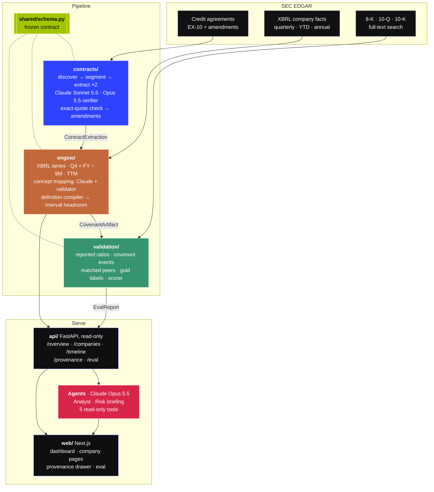
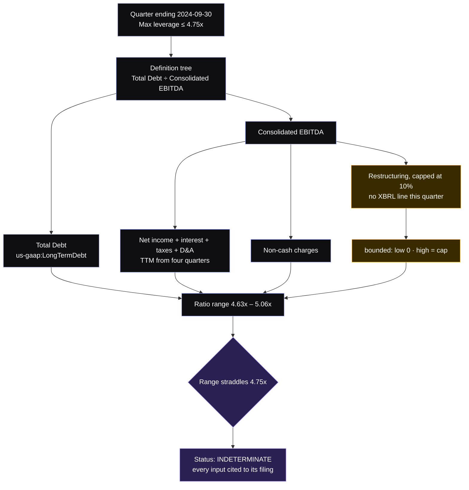
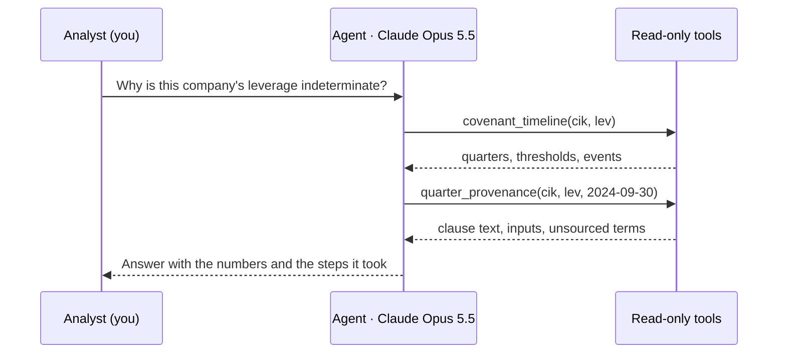

<div align="center">

# Covenant Watch

**Every loan covenant, rebuilt from the contract. Every number, cited to the filing.**

Covenant Watch reads a public company's credit agreement from SEC EDGAR, rebuilds each financial covenant exactly as the contract defines it, recomputes it every quarter from the company's own XBRL financials, and shows how much room is left before a breach. Two Claude agents sit on top: one answers questions, one writes risk briefings.


*Solix AI Hackathon 2026 · AI in Finance*

</div>

---

## The problem

A broken covenant is usually the first domino of default: the lender can call the loan, reprice it or take control. The terms that decide it are public, filed as exhibits on EDGAR, but almost nobody can use them:

- They live in 150 to 300 page credit agreements, changed by later amendments.
- They use the contract's own math. "Consolidated EBITDA" adds back restructuring, stock compensation, synergies and more, each with its own cap.
- Companies rarely report the ratio, and never show the working.

**The obvious shortcut is wrong.** We computed leverage from plain GAAP numbers for companies that do report their covenant ratio. GAAP came out higher every time:

| Company | Reported covenant leverage | Plain GAAP leverage |
|---|---:|---:|
| Dine Brands | 4.58x | 7.25x |
| OUTFRONT Media | 4.80x | 5.99x |
| Vishay Intertechnology | 3.14x | 4.18x |
| Concentra Group | 3.60x | 4.15x |
| MSCI | 2.70x | 3.28x |

The definitions are the product.

## What it does

1. **Reads the agreement.** Finds the credit agreement and every amendment, extracts each covenant, its step-down schedule and the full recursive definition tree (EBITDA, then net income, then each addback and its cap).
2. **Rebuilds the math.** Maps every term to the company's XBRL facts, compiles the definition tree into an executable graph and computes the ratio each quarter, against the limit in force that quarter.
3. **Tells the truth about uncertainty.** An addback with no public source becomes a range from zero to its contractual cap. If even the worst case breaches, that is a breach; if the range straddles the limit, it says *indeterminate*.
4. **Shows its work.** Click any quarter: the clause text highlighted in the filing, every input's XBRL concept, value and accession, and the mapping confidence.
5. **Proves itself.** Scores computed ratios against the ratios companies reported, and asks whether headroom fell before real waivers and defaults, compared with matched peers that had none.

## Architecture



### How one quarter gets computed



| Stage | Folder | What it produces |
|---|---|---|
| Contract reader | `contracts/` | `ContractExtraction`: covenants, thresholds with effective dates, definition trees, every field quoted from the filing |
| Engine | `engine/` | `CovenantArtifact`: per quarter ratio range, threshold, headroom range, status, missing inputs, full provenance |
| Validation | `validation/` | ground truth, matched peers, gold labels, `EvalReport` |
| API | `api/` | read-only FastAPI over everything above, plus the agents |
| Web | `web/` | Next.js: landing, dashboard, company pages, provenance drawer, evaluation |
| Contract | `shared/schema.py` | the frozen Pydantic schema every stage reads and writes |

### The engine, in more detail

- **XBRL series.** Quarterly values from 3-month facts, with missing quarters derived from year-to-date differences (Q4 = FY − 9M). Trailing twelve months from four contiguous quarters, or YTD + prior FY − prior-year YTD for items only reported year to date. Handles filers that switch tags over time and lines split across two tags (`Depreciation + OtherDepreciationAndAmortization`).
- **Concept mapping.** Claude proposes the XBRL concept for each contract term from the concepts this company actually reports. A deterministic validator checks unit, duration vs instant, sign and availability. Partial proxies (stock comp for "non-cash charges") only count toward the low case. Net-interest fallbacks are flagged and dropped in quarters where they flip to income.
- **Interval compiler.** Sum, subtract, ratio, percent-of-term and absolute caps, floors, evaluated in contract order with cycle detection. Interval arithmetic carries uncertainty from each unsourced addback through to the ratio and the headroom.

## Agents

Both agents run on **Claude Opus 5.5** and can only read: five tools over the same API the web app uses (`search_companies`, `portfolio_overview`, `covenant_timeline`, `quarter_provenance`, `company_refusals`). Every tool call is returned to the UI, so each answer can be traced to the data it used.



| Agent | Where | What it does |
|---|---|---|
| **Analyst** | floating panel on every page | Answers questions in context ("why is this quarter a range?", "which covenants are closest to breach?"), pulling timelines and provenance as needed and quoting the numbers it found. |
| **Risk briefing** | dashboard | Works on its own: finds the most at-risk covenants, reads each timeline and the filings behind the latest quarter, then writes a ranked memo covering where it stands now, the trend, what drives it, signals, and what to watch next. |

`POST /agent/ask` · `POST /agent/brief` · needs `ANTHROPIC_API_KEY` in the API process.

## Governed AI

| Where Claude is used | What checks it |
|---|---|
| Extracting covenants and definitions | Every field must be an exact substring of the filing at its offsets. Two extraction layouts must agree, or a verifier decides; unresolved items become refusals. Hard budget per run. |
| Mapping terms to XBRL concepts | Deterministic validator: units, period type, sign, availability. Rejected proposals stay unmapped and are bounded, not guessed. |
| Ground-truth extraction | Every number must appear verbatim in its quoted span. |
| Agents | Read-only tools, every step shown, instructed to quote numbers exactly and to say when the data does not answer the question. |

## Ground truth (real SEC data)

| | Count |
|---|---:|
| Company-reported covenant ratios | 387, across 156 companies |
| Disclosed covenant events (waivers, defaults, loosening amendments, accelerations) | 157, across 119 companies |
| Evaluation universe (event companies, matched peers, reporting companies) | 250 |
| Source quotes re-verified against the filings | 544 of 544 |
| Draft gold labels with an exact quote per field, awaiting human sign-off | 20 agreements |

## Quick start

```bash
uv sync
export SEC_USER_AGENT="Covenant Watch you@example.com"
export ANTHROPIC_API_KEY=...
uv run pytest                                        # 121 tests

uv run uvicorn api.main:app --port 8000              # API
cd web && npm install && npm run build && npm start  # http://localhost:3000
```

### Run the pipeline

```bash
uv run python -m validation.disclosed       # company-reported covenant ratios
uv run python -m validation.events          # waivers, defaults, loosening amendments
uv run python -m validation.universe        # data/universe.json from both
uv run python -m contracts.run --universe   # data/contracts/{cik}.json  (budgets: notes/laksh.md)
uv run python -m engine.run --universe      # data/artifacts/{cik}.json
uv run python -m validation.score           # data/eval/report.json
```

### Data sources the API can serve

| Source | How |
|---|---|
| Pipeline output | `data/artifacts/` has files |
| Example company | `data/artifacts/` empty: serves `fixtures/` |
| Demo portfolio | `uv run python -m validation.demo_data`, then start the API with `CW_DATASET=demo`. 100 fictional companies (CIKs 99xxxxxxxx, documents on example.invalid) run through the real engine and scorer, for exercising the product at volume. Their scores are not results. |

## Repository

```
shared/       frozen data contract, SEC client
fixtures/     example data in contract shape
contracts/    agreement reader (Laksh)
engine/       XBRL series, mapping, compiler, interval headroom (Dat)
validation/   ground truth, gold labels, scoring, demo portfolio (Dat)
api/          FastAPI and the agents (Dat)
web/          Next.js app (Dat)
notes/        handoffs between the two halves
```

Ownership rules: `AGENTS.md` · plan: `docs/PLAN.md`

<sub>Built on public SEC EDGAR filings. Not investment advice.</sub>
